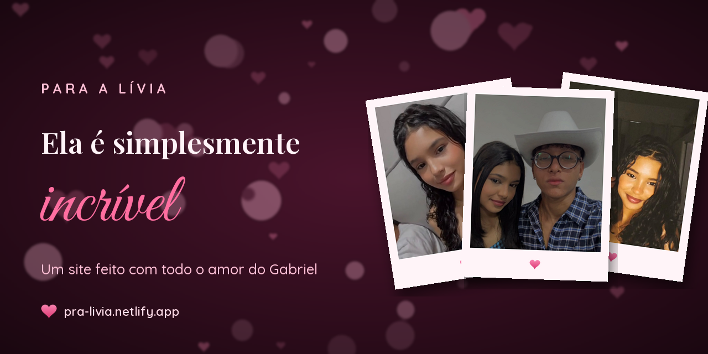

<div align="center">



# Ela é simplesmente incrível 💗

**Um site de homenagem feito com todo o amor do Gabriel para a Lívia.**
Nossos momentos, as fotos mais lindas dela, mensagens do coração, uma música especial
e um anel de diamante escrito em Python com as letras do nome dela.

[](https://pra-livia.netlify.app)
[](https://github.com/GabrielDS02/ela-simplesmente-incrivel/releases)

[](LICENSE)
[](LICENSE-CONTENT.md)
[](https://openfontlicense.org)


[**Ver o site**](https://pra-livia.netlify.app) · [Funcionalidades](#-funcionalidades) · [Como rodar](#-como-rodar-localmente) · [Deploy](#-deploy-no-netlify) · [Licenças](#-licenças)

</div>

---

## 💌 Sobre

Este é um presente. Um site de uma página só, feito para ser aberto pelo celular,
direto de um link no WhatsApp ou no Instagram, com o som ligado.

Ele abre com um envelope. Quando a Lívia toca em **Abrir**, a música começa
(*Thinking Out Loud*, do Ed Sheeran) e a página vai se revelando aos poucos:
fotos, mensagens curtas, cartas que viram, um anel girando com o nome dela e,
no final, um beijo esperando por ela.

## ✨ Funcionalidades

| | |
| --- | --- |
| 💌 **Abertura em envelope** | O toque dela abre o envelope e libera a música (é o que permite som no celular). |
| 🎵 **Player de música** | *Thinking Out Loud*, *It's You* e *Photograph*, pelo player oficial do YouTube, com play/pause e próxima faixa. |
| 💗 **Corações flutuando** | Fundo animado em `<canvas>`, que pausa sozinho quando a aba fica em segundo plano. |
| ⌨️ **Frases digitadas** | Mensagens que se escrevem sozinhas na capa. |
| 🃏 **Cartas que viram** | "Coisas que eu amo em você", reveladas a cada toque. |
| 📸 **Slideshow estilo stories** | Todas as fotos passando sozinhas, com barrinhas de progresso, swipe e legendas. |
| 🖼️ **Polaroids "Nós dois"** | As fotos do casal, como fotos jogadas na mesa. |
| 🔍 **Galeria + lightbox** | 21 fotos em mosaico, com zoom, swipe, setas do teclado e contador. |
| 💍 **Anel em Python** | Um anel de diamante feito com as letras de **LIVIA** e o nome *Lívia* brilhando no centro, renderizado em 3D por `tools/anel/anel.py`. |
| ✉️ **Carta** | Uma carta curta, em papel pautado. |
| 💋 **"Tem um beijo seu esperando aqui"** | Botões **Quero** e **Não quero** que mandam uma mensagem no WhatsApp do Gabriel. O "Não quero" foge algumas vezes antes de deixar ela clicar. 😏 |
| 👆 **Corações no toque** | Coraçõezinhos saem de onde ela tocar na tela. |

## 🚀 Qualidade

- **Responsivo de verdade**: pensado primeiro para o celular (iPhone e Android), e lindo no computador.
- **SEO completo**: título e descrição, `canonical`, Open Graph, Twitter Card, dados estruturados (JSON-LD), `robots.txt`, `sitemap.xml` e `lang="pt-BR"`.
- **Prévias bonitas nas redes**: banner 1200×630 para WhatsApp, Facebook, LinkedIn, X/Twitter, Telegram e Discord.
- **Favicons e PWA**: SVG, ICO, PNG, Apple Touch Icon, ícone *maskable* e `site.webmanifest` (dá pra adicionar à tela inicial).
- **Leve**: fotos em WebP com `srcset` (480 px no celular, 900 px no computador), *lazy loading* e vídeo do anel com ~440 KB que só carrega quando aparece na tela.
- **Acessível**: texto alternativo em todas as fotos, navegação por teclado, foco visível, link "pular para o conteúdo" e respeito a `prefers-reduced-motion`.
- **Seguro**: cabeçalhos no Netlify (CSP, HSTS, `X-Frame-Options`, `Referrer-Policy`, `Permissions-Policy`).
- **Zero dependências** no site: HTML, CSS e JavaScript puros, sem build.

## 📱 Banners para as redes

Todos gerados automaticamente por `tools/build_assets.py`:

| Arquivo | Tamanho | Onde usar |
| --- | --- | --- |
| [`assets/img/social/og-image.jpg`](assets/img/social/og-image.jpg) | 1200×630 | Prévia do link no WhatsApp, Facebook, LinkedIn, X/Twitter, Telegram, Discord |
| [`assets/img/social/instagram-post.jpg`](assets/img/social/instagram-post.jpg) | 1080×1080 | Post quadrado do Instagram |
| [`assets/img/social/instagram-retrato.jpg`](assets/img/social/instagram-retrato.jpg) | 1080×1350 | Post em retrato do Instagram (4:5) |
| [`assets/img/social/stories.jpg`](assets/img/social/stories.jpg) | 1080×1920 | Stories do Instagram e status do WhatsApp |
| [`docs/banner.png`](docs/banner.png) | 1280×640 | README e prévia social do GitHub |

> Dica: em **Settings → General → Social preview** do repositório, envie o `docs/banner.png` para o GitHub mostrar o banner quando o link do repo for compartilhado.

## 🗂️ Estrutura

```text
ela-simplesmente-incrivel/
├── index.html                 # a página (todas as seções, comentadas)
├── 404.html                   # página "se perdeu?"
├── favicon.svg
├── site.webmanifest           # PWA
├── robots.txt
├── sitemap.xml
├── netlify.toml               # deploy, cabeçalhos de segurança e cache
├── assets/
│   ├── css/style.css          # estilos (índice no topo do arquivo)
│   ├── js/main.js             # interações (CONFIG no topo do arquivo)
│   ├── img/
│   │   ├── fotos/             # livia-01…21 (.webp 900 px + -sm 480 px)
│   │   └── social/            # banners para as redes sociais
│   ├── icons/                 # favicons e ícones do app
│   └── video/                 # anel.mp4 + pôster
├── tools/
│   ├── anel/
│   │   ├── anel.py            # o anel de letras em 3D (Python)
│   │   └── requirements.txt
│   └── build_assets.py        # fotos, banners, ícones e galeria do HTML
└── docs/
    └── banner.png             # banner do README
```

## 💻 Como rodar localmente

Não precisa instalar nada para ver o site, só servir a pasta:

```bash
git clone https://github.com/GabrielDS02/ela-simplesmente-incrivel.git
cd ela-simplesmente-incrivel
python -m http.server 8080
```

E abrir <http://localhost:8080>.

> A música usa a API do YouTube, então ela só funciona por `http://` (não abrindo o arquivo com duplo clique).

### Personalizar

Tudo que é configurável fica no topo de [`assets/js/main.js`](assets/js/main.js), no objeto `CONFIG`:

```js
const CONFIG = {
  whatsapp: "55DDDNUMERO",          // número que recebe o "Quero" / "Não quero"
  messages: { yes: "…", no: "…" },  // mensagens que chegam no WhatsApp
  playlist: [ … ],                  // músicas (IDs do YouTube)
  typed: [ … ],                     // frases digitadas na capa
  slideDuration: 5000,              // tempo de cada foto no slideshow
};
```

### Regerar fotos, banners e ícones

As fotos originais ficam **fora** do repositório (em `../_originais/fotos`). Para regerar tudo:

```bash
pip install Pillow
python tools/build_assets.py            # ou: --fotos CAMINHO/DAS/FOTOS
```

O script trata as fotos (recorta os stories duplicados, clareia as escuras e salva em WebP),
gera os banners e os ícones, e reescreve a galeria do `index.html` com legendas e textos alternativos.

### O anel em Python 💍

```bash
pip install -r tools/anel/requirements.txt
python tools/anel/anel.py               # gera assets/video/anel.mp4 e o pôster
python tools/anel/anel.py --preview     # só um quadro de teste
```

Como ele funciona, sem nenhum programa 3D:

1. O aro é um **toro** e a pedra é um **diamante lapidado** com faces planas, tudo descrito como nuvens de pontos.
2. A cada quadro os pontos giram, são projetados em perspectiva numa grade de caracteres e passam por um **z-buffer**.
3. A luz (difusa + especular) define o brilho: no aro, cada célula vira uma letra de **LIVIA**; no diamante, as faces piscam conforme o ângulo.
4. O nome *Lívia* brilha no centro do aro, pulsando devagar.
5. Os glifos são pré-renderizados e o `ffmpeg` junta 240 quadros num loop perfeito de 8 segundos.

## 🌐 Deploy no Netlify

O site é estático, sem build. O `netlify.toml` já está pronto.

1. Entre em [app.netlify.com](https://app.netlify.com) → **Add new site → Import an existing project**.
2. Escolha o GitHub e o repositório `ela-simplesmente-incrivel`, branch `main`.
3. Deixe **Build command** vazio e **Publish directory** como `.` → **Deploy**.
4. Em **Site configuration → Change site name**, coloque `pra-livia`. O endereço fica **https://pra-livia.netlify.app**, que é o que já está no SEO e nos banners.

Depois disso, cada `push` na `main` publica o site sozinho.

> Mandou o link e a prévia não apareceu? O WhatsApp guarda as prévias em cache. Teste antes no
> [Facebook Sharing Debugger](https://developers.facebook.com/tools/debug/) e no
> [LinkedIn Post Inspector](https://www.linkedin.com/post-inspector/) para forçar a atualização.

## 📜 Licenças

Este repositório é público, mas **nem tudo nele é livre para reutilizar**:

| O quê | Licença |
| --- | --- |
| Código-fonte (HTML, CSS, JS, Python) | [MIT](LICENSE) |
| Fotos, textos pessoais e banners | **© Gabriel e Lívia, todos os direitos reservados** ([detalhes](LICENSE-CONTENT.md)) |
| Fontes (Great Vibes, Playfair Display, Quicksand) | [SIL Open Font License 1.1](https://openfontlicense.org) |
| Músicas | Direitos dos artistas. Nenhum áudio é hospedado aqui: elas tocam pelo player oficial do YouTube. |

Quer fazer uma homenagem assim para alguém? Faça um fork, **troque as fotos e os textos pelos seus** e use o código à vontade. 💗

Veja também: [Código de conduta](CODE_OF_CONDUCT.md) · [Como contribuir](CONTRIBUTING.md) · [Segurança](SECURITY.md) · [Changelog](CHANGELOG.md)

---

<div align="center">

Feito com 💗 pelo **Gabriel**, só pra **Lívia**.

*Porque ela é simplesmente incrível.*

</div>
